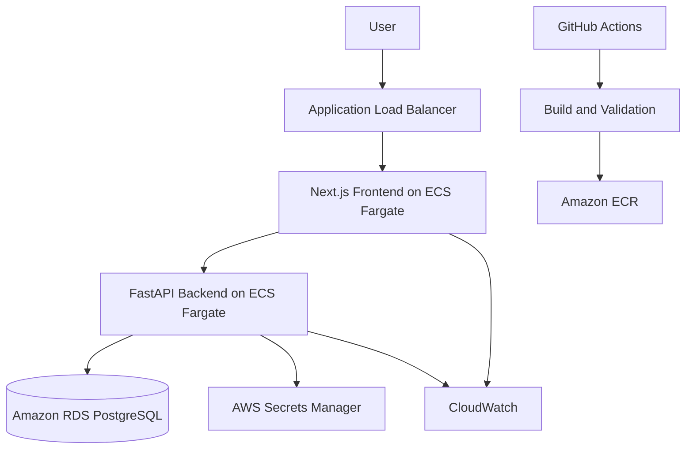

# AWS Architecture Diagram

## Deployment status

This diagram represents the intended architecture. Actual AWS deployment remains pending because CloudFormation operations are blocked by an AWS Organizations service control policy.
